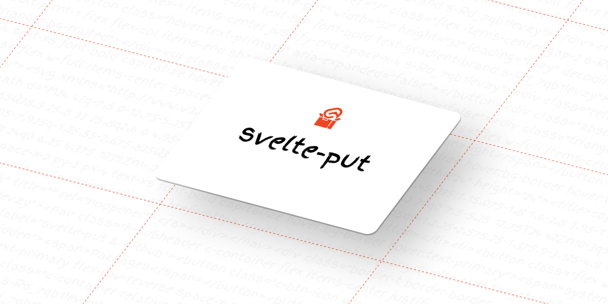

# [@svelte-put][docs]

[![MIT][license.badge]][license] [![MadeWithSvelte.com][madewithsvelte.badge]][madewithsvelte]

Useful svelte stuff to put in your projects

## Documentation

[See the dedicated documentation page here][docs].

## Packages

`@svelte-put` includes several packages that have self-managed release cycles, listed below. Check out their corresponding README for more details.

| Package                    | Short Description                                  | Version                                                                                 | Changelog                                                                | Docs                                                      |
| -------------------------- | -------------------------------------------------- | --------------------------------------------------------------------------------------- | ------------------------------------------------------------------------ | --------------------------------------------------------- |
| [async-stack]              | build type-safe and async component stack          | [![Open in npmx][async-stack.npmx.version]][async-stack.npmx]                           | [![Read changelog][badge.changelog]][async-stack.changelog]              | [![Read docs][badge.docs]][async-stack.docs]              |
| [avatar]                   | build user profile images aka avatars              | [![Open in npmx][avatar.npmx.version]][avatar.npmx]                                     | [![Read changelog][badge.changelog]][avatar.changelog]                   | [![Read docs][badge.docs]][avatar.docs]                   |
| [clickoutside]             | listen for clicks outside an element               | [![Open in npmx][clickoutside.npmx.version]][clickoutside.npmx]                         | [![Read changelog][badge.changelog]][clickoutside.changelog]             | [![Read docs][badge.docs]][clickoutside.docs]             |
| [cloudflare-turnstile]     | set up [Cloudflare Turnstile]                      | [![Open in npmx][cloudflare-turnstile.npmx.version]][cloudflare-turnstile.npmx]         | [![Read changelog][badge.changelog]][cloudflare-turnstile.changelog]     | [![Read docs][badge.docs]][cloudflare-turnstile.docs]     |
| [copy]                     | copy text to clipboard                             | [![Open in npmx][copy.npmx.version]][copy.npmx]                                         | [![Read changelog][badge.changelog]][copy.changelog]                     | [![Read docs][badge.docs]][copy.docs]                     |
| [dragscroll]               | set up drag-to-scroll pointer behavior             | [![Open in npmx][dragscroll.npmx.version]][dragscroll.npmx]                             | [![Read changelog][badge.changelog]][dragscroll.changelog]               | [![Read docs][badge.docs]][dragscroll.docs]               |
| [intersect]                | inline SVGs at build-time or runtime               | [![Open in npmx][intersect.npmx.version]][intersect.npmx]                               | [![Read changelog][badge.changelog]][intersect.changelog]                | [![Read docs][badge.docs]][intersect.docs]                |
| [inline-svg]               | set up [IntersectionObserver] for an element       | [![Open in npmx][inline-svg.npmx.version]][inline-svg.npmx]                             | [![Read changelog][badge.changelog]][inline-svg.changelog]               | [![Read docs][badge.docs]][inline-svg.docs]               |
| [lockscroll]               | lock scroll within a scroll container              | [![Open in npmx][lockscroll.npmx.version]][lockscroll.npmx]                             | [![Read changelog][badge.changelog]][lockscroll.changelog]               | [![Read docs][badge.docs]][lockscroll.docs]               |
| [movable]                  | move node on mousedown & mousemove                 | [![Open in npmx][movable.npmx.version]][movable.npmx]                                   | [![Read changelog][badge.changelog]][movable.changelog]                  | [![Read docs][badge.docs]][movable.docs]                  |
| [preprocess-external-link] | add attributes to external links at compile-time   | [![Open in npmx][preprocess-external-link.npmx.version]][preprocess-external-link.npmx] | [![Read changelog][badge.changelog]][preprocess-external-link.changelog] | [![Read docs][badge.docs]][preprocess-external-link.docs] |
| [qr]                       | render QR as svg or img, optionally with logo      | [![Open in npmx][qr.npmx.version]][qr.npmx]                                             | [![Read changelog][badge.changelog]][qr.changelog]                       | [![Read docs][badge.docs]][qr.docs]                       |
| [resize]                   | set up [ResizeObserver] for an element             | [![Open in npmx][resize.npmx.version]][resize.npmx]                                     | [![Read changelog][badge.changelog]][resize.changelog]                   | [![Read docs][badge.docs]][resize.docs]                   |
| [shortcut]                 | manage keyboard shortcuts                          | [![Open in npmx][shortcut.npmx.version]][shortcut.npmx]                                 | [![Read changelog][badge.changelog]][shortcut.changelog]                 | [![Read docs][badge.docs]][shortcut.docs]                 |
| [swipeable]                | set up swipe gestures                              | [![Open in npmx][swipeable.npmx.version]][swipeable.npmx]                               | [![Read changelog][badge.changelog]][swipeable.changelog]                | [![Read docs][badge.docs]][swipeable.docs]                |
| [toc]                      | collect Table-of-Contents at build-time or runtime | [![Open in npmx][toc.npmx.version]][toc.npmx]                                           | [![Read changelog][badge.changelog]][toc.changelog]                      | [![Read docs][badge.docs]][toc.docs]                      |

## Contributing

See [CONTRIBUTING][github.contributing] for guidelines.

<!-- github specifics -->

[github.contributing]: ./CONTRIBUTING.md
[github.issues]: https://github.com/vnphanquang/svelte-put/issues?q=

<!-- heading badge -->

[license.badge]: https://img.shields.io/badge/license-MIT-blue.svg
[license]: ./LICENSE
[madewithsvelte.badge]: https://madewithsvelte.com/storage/repo-shields/4070-shield.svg
[madewithsvelte]: https://madewithsvelte.com/p/svelte-put/shield-link

<!-- async-stack -->

[async-stack]: https://github.com/vnphanquang/svelte-put/tree/main/packages/async-stack
[async-stack.docs]: https://svelte-put.vnphanquang.com/docs/async-stack
[async-stack.npmx]: https://npmx.dev/package/@svelte-put/async-stack
[async-stack.npmx.version]: https://npmx.dev/api/registry/badge/version/@svelte-put/async-stack
[async-stack.changelog]: https://github.com/vnphanquang/svelte-put/blob/main/packages/async-stack/CHANGELOG.md

<!-- avatar -->

[avatar]: https://github.com/vnphanquang/svelte-put/tree/main/packages/avatar
[avatar.docs]: https://svelte-put.vnphanquang.com/docs/avatar
[avatar.npmx]: https://npmx.dev/package/@svelte-put/avatar
[avatar.npmx.version]: https://npmx.dev/api/registry/badge/version/@svelte-put/avatar
[avatar.changelog]: https://github.com/vnphanquang/svelte-put/blob/main/packages/avatar/CHANGELOG.md

<!-- clickoutside -->

[clickoutside]: https://github.com/vnphanquang/svelte-put/tree/main/packages/clickoutside
[clickoutside.docs]: https://svelte-put.vnphanquang.com/docs/clickoutside
[clickoutside.npmx]: https://npmx.dev/package/@svelte-put/clickoutside
[clickoutside.npmx.version]: https://npmx.dev/api/registry/badge/version/@svelte-put/clickoutside
[clickoutside.changelog]: https://github.com/vnphanquang/svelte-put/blob/main/packages/clickoutside/CHANGELOG.md

<!-- cloudflare-turnstile -->

[cloudflare-turnstile]: https://github.com/vnphanquang/svelte-put/tree/main/packages/cloudflare-turnstile
[cloudflare-turnstile.docs]: https://svelte-put.vnphanquang.com/docs/cloudflare-turnstile
[cloudflare-turnstile.npmx]: https://npmx.dev/package/@svelte-put/cloudflare-turnstile
[cloudflare-turnstile.npmx.version]: https://npmx.dev/api/registry/badge/version/@svelte-put/cloudflare-turnstile
[cloudflare-turnstile.changelog]: https://github.com/vnphanquang/svelte-put/blob/main/packages/cloudflare-turnstile/CHANGELOG.md

<!-- copy -->

[copy]: https://github.com/vnphanquang/svelte-put/tree/main/packages/copy
[copy.docs]: https://svelte-put.vnphanquang.com/docs/copy
[copy.npmx]: https://npmx.dev/package/@svelte-put/copy
[copy.npmx.version]: https://npmx.dev/api/registry/badge/version/@svelte-put/copy
[copy.changelog]: https://github.com/vnphanquang/svelte-put/blob/main/packages/copy/CHANGELOG.md

<!-- dragscroll -->

[dragscroll]: https://github.com/vnphanquang/svelte-put/tree/main/packages/dragscroll
[dragscroll.docs]: https://svelte-put.vnphanquang.com/docs/dragscroll
[dragscroll.npmx]: https://npmx.dev/package/@svelte-put/dragscroll
[dragscroll.npmx.version]: https://npmx.dev/api/registry/badge/version/@svelte-put/dragscroll
[dragscroll.changelog]: https://github.com/vnphanquang/svelte-put/blob/main/packages/dragscroll/CHANGELOG.md

<!-- intersect -->

[intersect]: https://github.com/vnphanquang/svelte-put/tree/main/packages/intersect
[intersect.docs]: https://svelte-put.vnphanquang.com/docs/intersect
[intersect.npmx]: https://npmx.dev/package/@svelte-put/intersect
[intersect.npmx.version]: https://npmx.dev/api/registry/badge/version/@svelte-put/intersect
[intersect.changelog]: https://github.com/vnphanquang/svelte-put/blob/main/packages/intersect/CHANGELOG.md

<!-- inline-svg -->

[inline-svg]: https://github.com/vnphanquang/svelte-put/tree/main/packages/inline-svg
[inline-svg.docs]: https://svelte-put.vnphanquang.com/docs/inline-svg
[inline-svg.npmx]: https://npmx.dev/package/@svelte-put/inline-svg
[inline-svg.npmx.version]: https://npmx.dev/api/registry/badge/version/@svelte-put/inline-svg
[inline-svg.changelog]: https://github.com/vnphanquang/svelte-put/blob/main/packages/inline-svg/CHANGELOG.md

<!-- lockscroll -->

[lockscroll]: https://github.com/vnphanquang/svelte-put/tree/main/packages/lockscroll
[lockscroll.docs]: https://svelte-put.vnphanquang.com/docs/lockscroll
[lockscroll.npmx]: https://npmx.dev/package/@svelte-put/lockscroll
[lockscroll.npmx.version]: https://npmx.dev/api/registry/badge/version/@svelte-put/lockscroll
[lockscroll.changelog]: https://github.com/vnphanquang/svelte-put/blob/main/packages/lockscroll/CHANGELOG.md

<!-- movable -->

[movable]: https://github.com/vnphanquang/svelte-put/tree/main/packages/movable
[movable.docs]: https://svelte-put.vnphanquang.com/docs/movable
[movable.npmx]: https://npmx.dev/package/@svelte-put/movable
[movable.npmx.version]: https://npmx.dev/api/registry/badge/version/@svelte-put/movable
[movable.changelog]: https://github.com/vnphanquang/svelte-put/blob/main/packages/movable/CHANGELOG.md

<!-- preprocess-external-link -->

[preprocess-external-link]: https://github.com/vnphanquang/svelte-put/tree/main/packages/preprocess-external-link
[preprocess-external-link.docs]: https://svelte-put.vnphanquang.com/docs/preprocess-external-link
[preprocess-external-link.npmx]: https://npmx.dev/package/@svelte-put/preprocess-external-link
[preprocess-external-link.npmx.version]: https://npmx.dev/api/registry/badge/version/@svelte-put/preprocess-external-link
[preprocess-external-link.changelog]: https://github.com/vnphanquang/svelte-put/blob/main/packages/preprocess-external-link/CHANGELOG.md

<!-- qr -->

[qr]: https://github.com/vnphanquang/svelte-put/tree/main/packages/qr
[qr.docs]: https://svelte-put.vnphanquang.com/docs/qr
[qr.npmx]: https://npmx.dev/package/@svelte-put/qr
[qr.npmx.version]: https://npmx.dev/api/registry/badge/version/@svelte-put/qr
[qr.changelog]: https://github.com/vnphanquang/svelte-put/blob/main/packages/qr/CHANGELOG.md

<!-- resize -->

[resize]: https://github.com/vnphanquang/svelte-put/tree/main/packages/resize
[resize.docs]: https://svelte-put.vnphanquang.com/docs/resize
[resize.npmx]: https://npmx.dev/package/@svelte-put/resize
[resize.npmx.version]: https://npmx.dev/api/registry/badge/version/@svelte-put/resize
[resize.changelog]: https://github.com/vnphanquang/svelte-put/blob/main/packages/resize/CHANGELOG.md

<!-- shortcut -->

[shortcut]: https://github.com/vnphanquang/svelte-put/tree/main/packages/shortcut
[shortcut.docs]: https://svelte-put.vnphanquang.com/docs/shortcut
[shortcut.npmx]: https://npmx.dev/package/@svelte-put/shortcut
[shortcut.npmx.version]: https://npmx.dev/api/registry/badge/version/@svelte-put/shortcut
[shortcut.changelog]: https://github.com/vnphanquang/svelte-put/blob/main/packages/shortcut/CHANGELOG.md

<!-- swipeable -->

[swipeable]: https://github.com/vnphanquang/svelte-put/tree/main/packages/swipeable
[swipeable.docs]: https://svelte-put.vnphanquang.com/docs/swipeable
[swipeable.npmx]: https://npmx.dev/package/@svelte-put/swipeable
[swipeable.npmx.version]: https://npmx.dev/api/registry/badge/version/@svelte-put/swipeable
[swipeable.changelog]: https://github.com/vnphanquang/svelte-put/blob/main/packages/swipeable/CHANGELOG.md

<!-- toc -->

[toc]: https://github.com/vnphanquang/svelte-put/tree/main/packages/toc
[toc.docs]: https://svelte-put.vnphanquang.com/docs/toc
[toc.npmx]: https://npmx.dev/package/@svelte-put/toc
[toc.npmx.version]: https://npmx.dev/api/registry/badge/version/@svelte-put/toc
[toc.changelog]: https://github.com/vnphanquang/svelte-put/blob/main/packages/toc/CHANGELOG.md

<!-- package links -->

[badge.changelog]: https://img.shields.io/badge/-Changelog-blue
[badge.docs]: https://img.shields.io/badge/-Docs%20Site-blue

<!-- misc -->

[docs]: https://svelte-put.vnphanquang.com
[Cloudflare Turnstile]: https://developers.cloudflare.com/turnstile/
[IntersectionObserver]: https://developer.mozilla.org/en-US/docs/Web/API/Intersection_Observer_API
[ResizeObserver]: https://developer.mozilla.org/en-US/docs/Web/API/Resize_Observer_API
